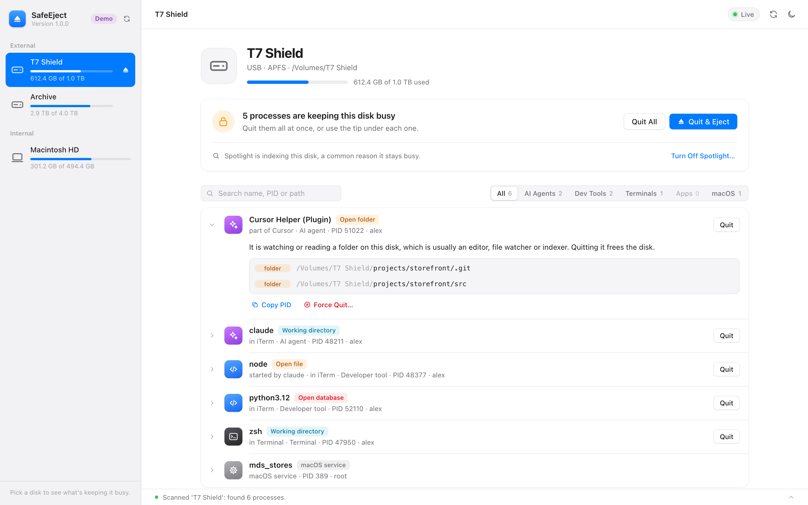

<p align="center">
  
</p>

<h1 align="center">SafeEject</h1>

<p align="center">
  <strong>See what's keeping your Mac's external drive busy, find out why, and eject it safely.</strong><br>
  For AI agents, terminals and dev servers that never let go of a disk.
</p>

<p align="center">
  <a href="https://github.com/CareoLimited/safe-eject/actions/workflows/tests.yml"></a>
  
  
  
  <a href="LICENSE"></a>
</p>

<p align="center">
  <a href="#install">Install</a> ·
  <a href="#what-safeeject-does">Features</a> ·
  <a href="#command-line">Command line</a> ·
  <a href="#security">Security</a>
</p>

<picture>
  <source media="(prefers-color-scheme: dark)" srcset="docs/screenshot-dark.png">
  
</picture>

---

## The problem

You try to eject an external drive and Finder says:

> *The disk wasn't ejected because one or more programs may be using it.*

Even after you close your AI agents (Claude, Codex, Cursor…) and terminal windows, something in the background often still holds the disk: a shell whose working directory is on it, an open SQLite `-wal` file, a language server, a file watcher. Most people give up and use **Force Eject**, which risks data loss.

## What SafeEject does

- **Finds every process holding the disk.** It scans the volume with `lsof`. A failed or partial scan is reported as a failure, never as a clean disk.
- **Tells you why each one holds it.** Each process gets a plain-language reason and a suggested fix:
  - **Working directory:** a shell is sitting in a folder on the disk. Run `cd ~` in that tab; there's no need to quit anything.
  - **Open database:** quit the app normally so it can finish writing. Force quitting can corrupt the database.
  - **Runs from this disk, loaded in memory, open file, open folder:** each comes with its own short explanation.
- **Shows where it came from.** For example, `node · started by claude · in iTerm`, so you know which window to close.
- **Quit & eject in one go.** It asks every process to quit, offers a force quit only for the ones that refuse, and then ejects. macOS services such as Spotlight let go by themselves and are left alone.
- **Turns off Spotlight for a disk.** Spotlight indexing is a common reason a disk stays busy. macOS asks for your password when needed.
- **Small helpers:**
  - Groups processes as AI agents, dev tools, terminals, apps and macOS services.
  - Search, Show in Finder, copy PID.
  - Light and dark themes.
  - A macOS notification when the disk is ejected.
- **Live mode.** It re-scans every 3 seconds and pauses while the tab is in the background.
- **No dependencies.** A single Python file using only the standard library. No `pip install`, no `npm install`.

## Install

### Homebrew (recommended)

```bash
brew install careolimited/tap/safe-eject
```

Then start it with:

```bash
safe-eject
```

The dashboard opens in your browser at `http://127.0.0.1:5005`. Update later with `brew upgrade safe-eject`.

### From source

You need macOS and Python 3.9 or newer. If `python3` isn't there yet, macOS offers to install the Command Line Tools the first time you run it, and that is enough.

```bash
git clone https://github.com/CareoLimited/safe-eject.git
cd safe-eject
python3 safe_eject.py
```

After cloning you can also start it by double-clicking **`SafeEject.command`** in Finder.

> **Downloaded the ZIP instead?** Unzip it and run `python3 safe_eject.py` from Terminal inside the folder. Don't double-click `SafeEject.command` from a ZIP download: the file isn't signed, so macOS Gatekeeper blocks it. Homebrew and `git clone` don't have this problem.

### Just want to look around?

Demo mode shows made-up disks and processes and never touches anything real:

```bash
safe-eject --demo
```

From source, that's `python3 safe_eject.py --demo`.

> **Tip:** Don't start SafeEject from a terminal whose working directory is on the disk you want to eject, because that terminal is itself holding the disk. Start it from your home folder, or use the Homebrew command.

## Command line

```bash
# List mounted volumes
safe-eject --list

# Show what is holding a volume, and why
safe-eject --scan /Volumes/MyDisk

# Close everything holding it (asks first; --yes skips the question, --force uses SIGKILL)
safe-eject --kill-all /Volumes/MyDisk

# Eject it
safe-eject --eject /Volumes/MyDisk
```

From source, use `python3 safe_eject.py` in place of `safe-eject`. Other options: `--port 8080` uses another port, `--no-browser` doesn't open the browser, and `--version` prints the version.

Example output:

```
[48377] node (alex) · Developer tool · started by claude, in iTerm
     ↳ working directory  /Volumes/MyDisk/projects/storefront
     ↳ open file          /Volumes/MyDisk/projects/storefront/node_modules/.vite/deps/_metadata.json
```

The commands exit with a non-zero status when a scan, close or eject fails, so you can use them in scripts.

## Security

SafeEject can terminate processes, so its local API is locked down:

- **Local only.** The server listens only on `127.0.0.1` and can't be exposed to the network.
- **No outgoing connections.** It makes no outgoing network requests and stores nothing.
- **Origin checks.** Every request's `Host` and `Origin` are checked and no cross-origin access is granted, which blocks malicious websites and DNS rebinding.
- **Session token.** Actions need a JSON body and a per-launch session token sent in the `X-SafeEject-Token` header. The dashboard handles this for you.
- **Safe defaults.**
  - The system disk can't be ejected, and processes on it can't be closed in bulk.
  - Show in Finder only works for files on mounted disks.
  - Spotlight changes go through the standard macOS password dialog. The disk path is passed as an argument, never pasted into a shell command.

## Limitations

- **Visibility.** Without root, `lsof` only sees processes you are allowed to inspect. Processes owned by other users or by the system may not show up.
- **Categories.** Process groups are based on process names, so an unfamiliar tool may land in the generic "App" group.

## Running the tests

```bash
python3 -m unittest discover tests/
node tests/test_app.js
```

The tests mock every disk command and signal, so they never list, scan, eject or terminate anything for real. Node.js is only needed for the dashboard tests.

## Project layout

```
safe-eject/
├── safe_eject.py          # Engine, CLI, demo data and local API server
├── SafeEject.command      # Double-click launcher for cloned copies
├── web/
│   ├── index.html         # Dashboard
│   ├── style.css          # Light and dark theme styles
│   └── app.js             # Dashboard logic
├── packaging/homebrew/    # Homebrew formula and the script that updates it for a release
├── docs/                  # Icon, screenshots and social preview image
└── tests/
    ├── test_safe_eject.py # Python tests
    └── test_app.js        # Dashboard tests
```

## License

[MIT](LICENSE) © 2026 Careo Limited
